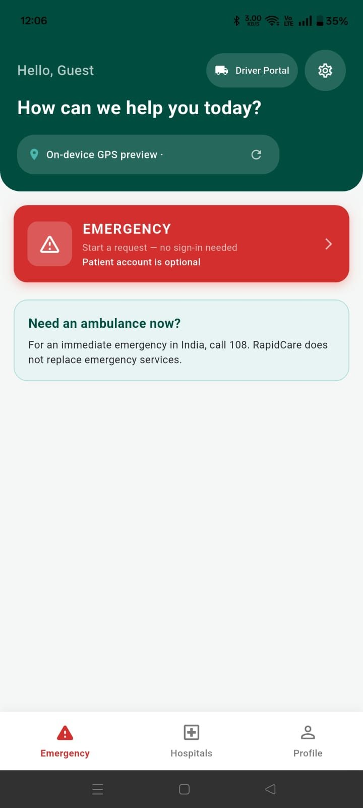
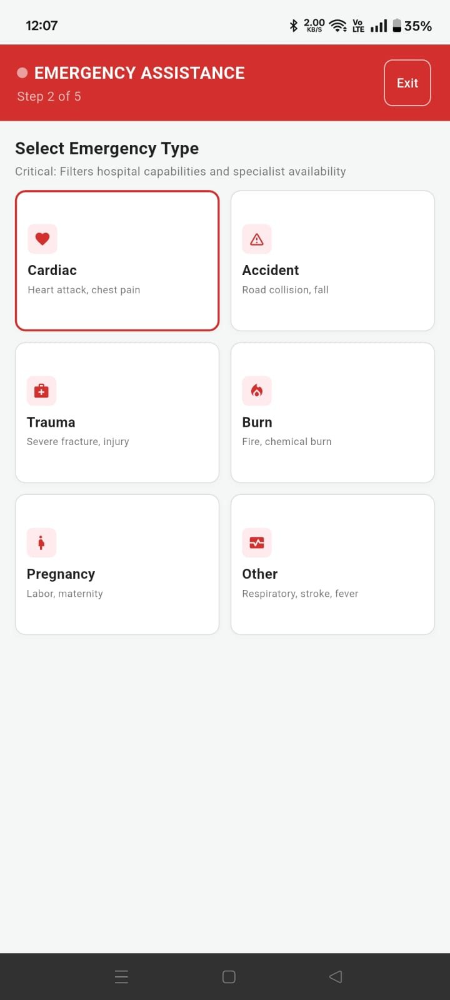
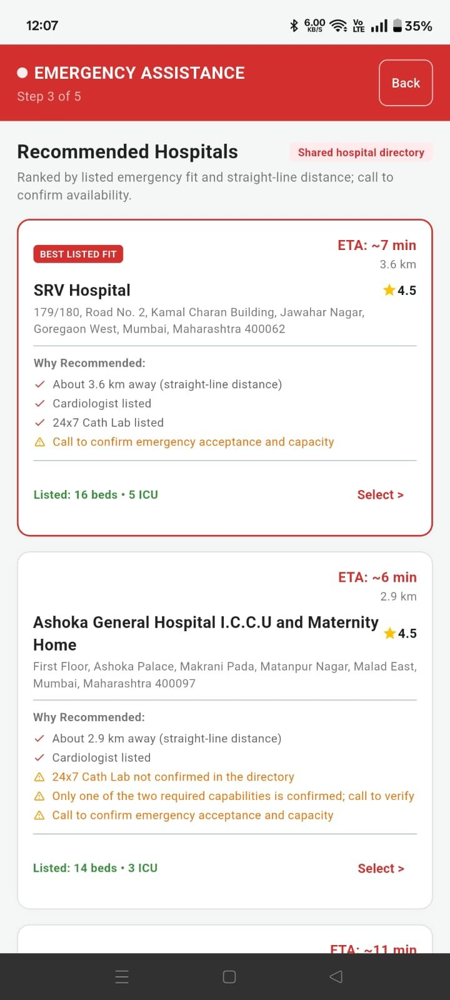
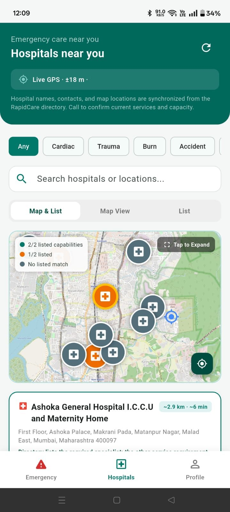

# RapidCare — Smart Emergency Healthcare Platform

RapidCare is an academic project focused on making emergency healthcare access easier. It brings together a mobile application and a backend API to support emergency patient requests and ambulance-related workflows.

## Project overview

The repository contains two main parts:

- **Flutter mobile application** in `rapidcare_app/`
- **Python Flask backend** in `rapidcare_backend/`

The backend exposes API routes for service health, user authentication, hospital information and ambulance requests. The mobile application is the user-facing part of the project.

## Application screenshots

These screenshots show the RapidCare mobile application running on an Android device. Precise location coordinates have been removed for privacy.

<table>
  <tr>
    <th>Home screen</th>
    <th>Emergency type selection</th>
  </tr>
  <tr>
    <td></td>
    <td></td>
  </tr>
  <tr>
    <th>Recommended hospitals</th>
    <th>Hospital directory</th>
  </tr>
  <tr>
    <td></td>
    <td></td>
  </tr>
</table>

## Technology

| Area | Technology |
| --- | --- |
| Mobile application | Flutter, Dart |
| Backend API | Python, Flask |
| ORM / database layer | Flask-SQLAlchemy |
| API support | Flask-CORS, Flask-JWT-Extended |

The backend's current local-development documentation describes SQLite. Refer to the backend configuration and deployment settings when checking the database used in a particular environment.

## Repository structure

```text
RapidCare/
├── rapidcare_app/       # Flutter mobile application
├── rapidcare_backend/   # Flask API and backend models
├── backend/             # Additional backend-related project files
├── screenshots/         # Optimized application screenshots
└── SRS/                 # Software Requirements Specification
```

## Run the Flutter application

Make sure Flutter is installed, then run:

```bash
cd rapidcare_app
flutter pub get
flutter run
```

## Run the backend locally

The backend has its own setup notes and dependency list:

- [Backend README](rapidcare_backend/README.md)
- [Backend dependencies](rapidcare_backend/requirements.txt)

Use the environment variables and database configuration appropriate to your local setup. Do not commit passwords, API keys or production secrets.

## API routes documented in the backend

| Method | Route | Purpose |
| --- | --- | --- |
| GET | `/` | Service status |
| GET | `/health` | Health check |
| POST | `/register` | Create a test user |
| POST | `/login` | Authenticate a user |
| GET | `/hospitals/` | List hospitals |
| GET | `/hospitals/<id>` | Retrieve hospital details |
| POST | `/ambulance/request` | Submit an ambulance request |
| GET | `/ambulance/requests` | List ambulance requests (development/admin) |

## Project status

This repository represents an academic software project. Review the source code and configuration for the exact features available in the current checkout; the API table above reflects the routes documented by the backend README.

---

Created by **Krishna Satpute** as an academic project.
